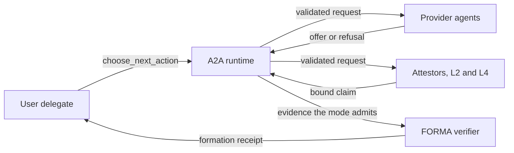
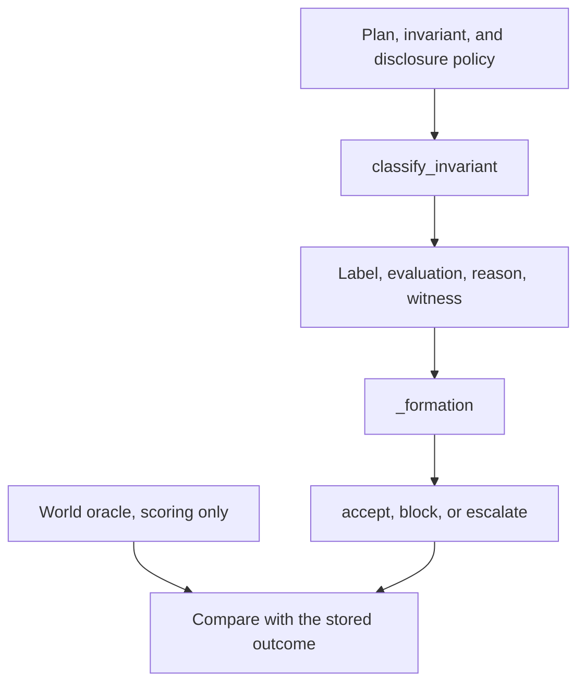
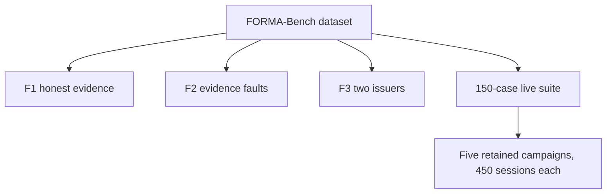

# FORMA replication package

Architectural verifiability for agent-to-agent systems. This repository is the code and the retained records for the reported evaluation. Clone it, install the pinned dependencies, and run the test suite. The deterministic checks recompute the stored results. The live campaigns are retained executions, so you inspect them rather than call the providers again.

## Start here

Python 3.11 or newer.

```bash
git clone https://github.com/ResearchAnonymized/FORMA.git
cd FORMA
python3 -m venv .venv
source .venv/bin/activate
python -m pip install pytest "a2a-sdk[http-server]==1.2.3" "uvicorn==0.38.0"
python -m pytest -q
```

A passing run is the replication check. On the machine used to prepare this package it finished in about half a minute. `pyproject.toml` adds `src` to the pytest path.

After the tests pass, read one deterministic summary and one live aggregate:

```bash
python -c "import json; print(json.load(open('fixtures/forma_bench_results_rq1/summary.json'))['phase'])"
python -c "import json; p='fixtures/live_a2a_multimodel_results/l33c-openrouter-openai-gpt-6.1-sol-r2-75/aggregate.json'; d=json.load(open(p)); print(d['session_level_formation_concordance'], d['strict_case_level_reliability'])"
```

Leave the files under `fixtures/` unchanged. The tests compare the runners with those files in memory. Calling `write_outputs` on a stored result directory would replace a retained record.

## Architecture

Three separately owned roles meet in one local runtime. Provider agents keep their own vaults. The delegate may only choose the next permitted action. The verifier decides formation.



The model does not assign the checkability label, the evaluation, or the formation decision. Expected labels and the world oracle stay out of the model-facing payload.

## One verification call

`classify_invariant` in `src/forma/classifier.py` takes a plan, an invariant, and a disclosure policy. It copies those inputs, names a verification structure, and evaluates only the attributes the checker is allowed to read. `classification_label` in `src/forma/labels.py` then assigns one label. Formation is a later rule, `_formation`, used by the experiment runner and by the live verifier. The world oracle scores the run. It is not an input to the classifier.



A checkable label means the permitted view can decide the invariant. It does not mean the invariant holds. Under T0, formation accepts only when the label is checkable and the evaluation is `holds`. Every other T0 outcome blocks.

| Label | When it is assigned |
| --- | --- |
| `not_checkable` | The formula names a missing attribute, or no accountable recovery delegate is reachable. |
| `evidence_distributed` | The evidence is present and unusable: hidden, weak, or the wrong audience. The evaluation is null. |
| `checkable_public` | The deciding evidence is public. |
| `checkable_by_bounded_assertion` | A permitted read is an owner assertion. |
| `checkable_with_escalation` | A permitted read is attested, or is otherwise not public evidence. |

`docs/FORMA_APPROACH_DESCRIPTION.md` is the implementation-grounded description. `research/CORE_SPEC_v0.2.md` and the two amendments beside it are the contract.

## How the reported records fit together

FORMA-Bench is the controlled dataset. F1 evaluates honest evidence. F2 injects evidence faults on top of that setting. F3 evaluates two issuers. The live suite is compiled from stored anchors, and each campaign repeats the same 150 cases three times.



Historical F1 and F2 remain because F3 and the live-suite compiler record those digests. The directories ending in `_rq1` are the corrected conjunction-rule rerun. `docs/RQ1_CORRECTION.md` lists the fields that changed. F3 did not change under that rerun.

| Record | Path | Digest |
| --- | --- | --- |
| Dataset | `fixtures/forma_bench/` | `60758c7040bb30ba10e7a3b77818b790c5613aa62fcfafbe408a3eadadc9b52a` |
| Historical F1 | `fixtures/forma_bench_results/` | `8c9106f0dc63eda4c73cc4b96d7fcb69c77f118e4f3aa83352391da555d564ee` |
| Corrected F1 | `fixtures/forma_bench_results_rq1/` | `f2bff3defbf63b4653c10fb7d7e392a4ce45cf261ff817fac298c8cb15d2d45c` |
| Historical F2 | `fixtures/forma_bench_fault_results/` | `5c658a2bfb2d3448de23c1601f5a205908451a90f9f8fdf65c7ac969cc416b3f` |
| Corrected F2 | `fixtures/forma_bench_fault_results_rq1/` | `63f33d5746571834dbbbcaeb26e09350131218e194aea74ceb23300258664f1e` |
| F3 | `fixtures/forma_bench_trust_results/` | `642a5cf9e3eff12c5d88123c5500aef9906521faa84765ccaac1b4dee74f28cb` |

Each deterministic directory contains `summary.json`, `world_results.json`, and `results.sha256`. The digest is the SHA-256 of the canonical JSON object `{"summary": summary, "world_results": world_results}`, with sorted keys and no extra whitespace. The functions are `results_digest` in `src/forma/benchmark/evaluate.py`, `src/forma/benchmark/faults.py`, and `src/forma/benchmark/trust_diversification.py`.

Reported counts are in `summary.json` for FORMA-Bench and in `aggregate.json` for a live campaign. This repository has no separate figure generator.

## Live campaigns

All five campaigns use one frozen contract: temperature 0, a 768-token output cap, and the same prompt, action schema, and suite.

| Hash | Value |
| --- | --- |
| Prompt | `0a63f3e04b8363353266c400250c79073b0ea820d991e099fb947843879d4882` |
| Action schema | `d305e727fb54a95de2674cc6c5e7250fa731dbe6fd42c835a2ae43e12be904d3` |
| Suite | `698ede288014061fc8b5c02f4fdbac3095a8ef19d18984b04e3472eb86eae0b1` |

The prompt text and the schema are the constants in `src/forma/live_runtime/llm_contract.py`. `prompt_template_sha256` and `schema_sha256` are computed from those constants. Each `campaign_manifest.json` stores the same three hashes.

| Directory | Requested model | Concordant sessions | Strict cases |
| --- | --- | --- | --- |
| `l33c-openrouter-openai-gpt-6.1-sol-r2-75` | `openai/gpt-6.1-sol` | 450/450 | 150/150 |
| `l34a-openrouter-anthropic-claude-haiku-5-5-75` | `anthropic/claude-haiku-5.5` | 426/450 | 137/150 |
| `l35-openrouter-google-gemini-3-8-flash-75` | `google/gemini-3.8-flash` | 313/450 | 57/150 |
| `l36-openrouter-deepseek-v4-1-flash-1017-75` | `deepseek/deepseek-v4.1-flash-1017` | 396/450 | 101/150 |
| `l38-openrouter-x-ai-grok-4-7-20260916-75` | `x-ai/grok-4.7` | 450/450 | 150/150 |

Concordance means the verifier receipt matches the frozen expected formation for that case. It is not an independent accuracy claim about the model.

For one campaign, start with these files:

| File | What it tells you |
| --- | --- |
| `campaign_manifest.json` | Model, temperature, token cap, and the three contract hashes |
| `aggregate.json` | Session concordance, strict-case reliability, and status counts |
| `sessions/` | One terminal record per session |
| `traces/` | The action trace and the formation receipt |
| `call_ledger.jsonl` | Priced provider calls, where that campaign recorded them |

`l34-openrouter-anthropic-claude-opus-5-5-75` is the incompatible gate that preceded the Haiku campaign. It has no performance result. It remains because a retained test pins its capability-gate digest.

A new provider call needs a credential in the process environment. This repository does not contain one. A later call is a new execution: hosted models and routes change. The retained sessions, traces, ledgers, manifests, and aggregates are the reported executions.

## Where to go next

| Question | Read |
| --- | --- |
| What each directory is for | `RELEASE_SCOPE.md` |
| How a check is computed | `docs/FORMA_APPROACH_DESCRIPTION.md` |
| What the corrected rerun changed | `docs/RQ1_CORRECTION.md` |
| Dataset contents | `docs/FORMA_BENCH_DATASET_CARD_v0.1.md` |
| Live protocol and limits | `research/LIVE_A2A_MULTIMODEL_EVALUATION_PROTOCOL_v0.1.md` |

## Package notes

Provider account identifiers that remained inside stored error text are `[redacted]`. Paths that named the original machine are relative to this repository. Those fields locate a local runtime directory. They are not part of the formation decision.
