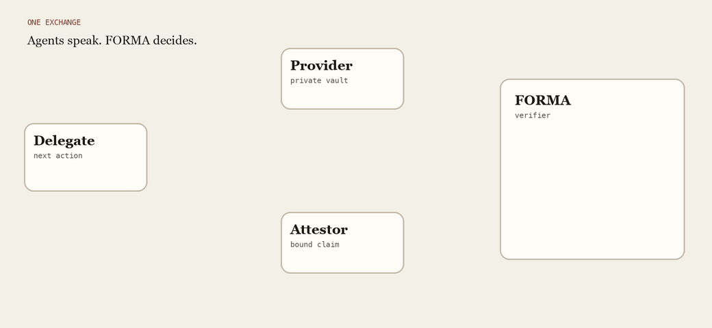

# FORMA

Architectural verifiability for agent-to-agent systems.



Three recorded exchanges from procurement case `fb-pbi-00`. The buyer asks whether the supplier prices sum to at most 80. Self-asserted prices are not an accepted strength, so FORMA leaves them unread and blocks. Selective disclosure then reveals the stored prices. On `hold_below` those prices are 1 and 1, the sum holds, and formation accepts. On the world where one price is 90, the sum is 91, the comparison is violated, and formation blocks. The same disclosure does not force accept.

The same sequence plays on the [welcome page](https://researchanonymized.github.io/FORMA/). This repository holds the implementation, FORMA-Bench, and the retained evaluation records.

## Run the checks

Python 3.11 or newer.

```bash
git clone https://github.com/ResearchAnonymized/FORMA.git
cd FORMA
python3 -m venv .venv
source .venv/bin/activate
python -m pip install pytest "a2a-sdk[http-server]==1.2.3" "uvicorn==0.38.0"
python -m pytest -q
```

A passing run recomputes the deterministic evaluations and reads the retained live records. On the machine used to prepare this package it finished in about half a minute.

## Use FORMA-Bench

The benchmark is included. The dataset is `fixtures/forma_bench/dataset.json`. The runners are `src/forma/benchmark/`. The full guide is [BENCHMARK.md](BENCHMARK.md).

Confirm the retained digests:

```bash
export PYTHONPATH=src
python scripts/forma_bench.py check
```

Rebuild into `runs/`, which is gitignored and does not replace the retained files:

```bash
python scripts/forma_bench.py dataset
python scripts/forma_bench.py f1
python scripts/forma_bench.py f2
python scripts/forma_bench.py f3
```

`dataset` rebuilds the 100 anchors, 582 worlds, and 500 configurations. `f1` evaluates honest evidence. `f2` injects the evidence faults. `f3` evaluates two issuers. Each command prints a digest. [BENCHMARK.md](BENCHMARK.md) gives the expected values, the S0–S4 configurations, and the fault profiles.

## Retained records

| Record | Path | Digest |
| --- | --- | --- |
| Dataset | `fixtures/forma_bench/` | `60758c7040bb30ba10e7a3b77818b790c5613aa62fcfafbe408a3eadadc9b52a` |
| Historical F1 | `fixtures/forma_bench_results/` | `8c9106f0dc63eda4c73cc4b96d7fcb69c77f118e4f3aa83352391da555d564ee` |
| Corrected F1 | `fixtures/forma_bench_results_rq1/` | `f2bff3defbf63b4653c10fb7d7e392a4ce45cf261ff817fac298c8cb15d2d45c` |
| Historical F2 | `fixtures/forma_bench_fault_results/` | `5c658a2bfb2d3448de23c1601f5a205908451a90f9f8fdf65c7ac969cc416b3f` |
| Corrected F2 | `fixtures/forma_bench_fault_results_rq1/` | `63f33d5746571834dbbbcaeb26e09350131218e194aea74ceb23300258664f1e` |
| F3 | `fixtures/forma_bench_trust_results/` | `642a5cf9e3eff12c5d88123c5500aef9906521faa84765ccaac1b4dee74f28cb` |

Historical F1 and F2 stay because F3 and the live-suite compiler record those digests. The `_rq1` directories are the corrected conjunction-rule rerun. [docs/RQ1_CORRECTION.md](docs/RQ1_CORRECTION.md) lists the fields that changed.

Reported counts are in `summary.json` for FORMA-Bench and in `aggregate.json` for a live campaign.

## Live campaigns

Five campaigns repeat one frozen 150-case suite three times. Temperature is 0. The output cap is 768 tokens. Prompt, action schema, and suite hashes are in each `campaign_manifest.json`, and the prompt text is in `src/forma/live_runtime/llm_contract.py`.

| Directory | Requested model | Concordant sessions | Strict cases |
| --- | --- | --- | --- |
| `l33c-openrouter-openai-gpt-6.1-sol-r2-75` | `openai/gpt-6.1-sol` | 450/450 | 150/150 |
| `l34a-openrouter-anthropic-claude-haiku-5-5-75` | `anthropic/claude-haiku-5.5` | 426/450 | 137/150 |
| `l35-openrouter-google-gemini-3-8-flash-75` | `google/gemini-3.8-flash` | 313/450 | 57/150 |
| `l36-openrouter-deepseek-v4-1-flash-1017-75` | `deepseek/deepseek-v4.1-flash-1017` | 396/450 | 101/150 |
| `l38-openrouter-x-ai-grok-4-7-20260916-75` | `x-ai/grok-4.7` | 450/450 | 150/150 |

Open `aggregate.json` first, then `sessions/` and `traces/`. Concordance means the verifier receipt matches the frozen expected formation. This repository does not contain a provider credential. The retained files are the reported executions.

`l34-openrouter-anthropic-claude-opus-5-5-75` is an incompatible gate with no performance result. A retained test pins its digest.

## Further reading

| Question | Document |
| --- | --- |
| How to run FORMA-Bench | [BENCHMARK.md](BENCHMARK.md) |
| What each directory is for | [RELEASE_SCOPE.md](RELEASE_SCOPE.md) |
| How a check is computed | [docs/FORMA_APPROACH_DESCRIPTION.md](docs/FORMA_APPROACH_DESCRIPTION.md) |
| Dataset card | [docs/FORMA_BENCH_DATASET_CARD_v0.1.md](docs/FORMA_BENCH_DATASET_CARD_v0.1.md) |
| Contract | [research/CORE_SPEC_v0.2.md](research/CORE_SPEC_v0.2.md) |
